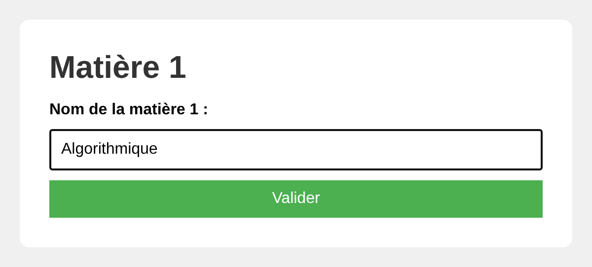
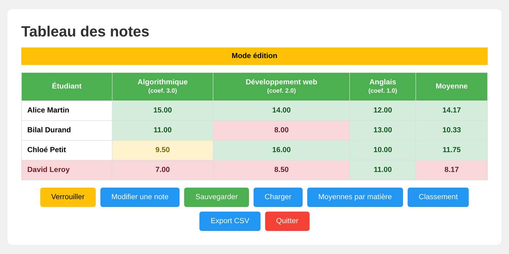
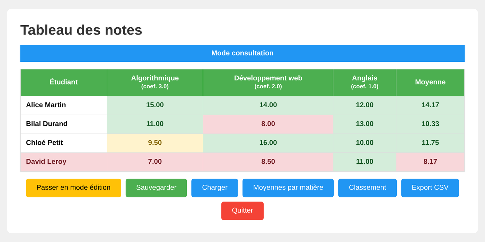
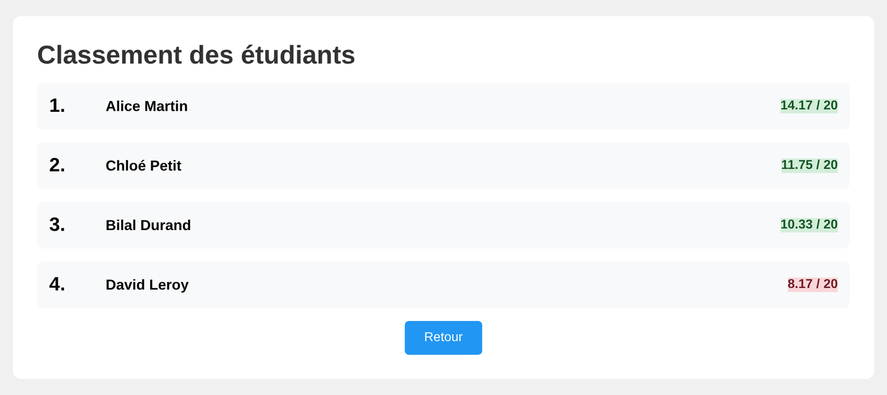

# SAÉ 1.01 — gestion des notes d'une promotion

**Implémentation d'un besoin client** · BUT informatique S1 · décembre 2025 – janvier 2026
Équipe : Benjamin BOUTOUT, Louis CARON, Marie TIERS (groupe 20).

## le besoin

Un programme Java dialogue avec le **navigateur web** grâce à la bibliothèque pédagogique *Navigator*
(un nano-serveur local fourni par l'IUT). Il doit permettre de :

- saisir les **matières**, leurs **coefficients** et les **étudiants** ;
- saisir les notes, puis basculer entre un **mode consultation** et un **mode édition** ;
- calculer automatiquement les **moyennes générales pondérées** ;
- **sauvegarder** et **recharger** les notes dans un fichier choisi par l'utilisateur ;
- colorer les notes satisfaisantes (≥ 10), moyennes (≥ 9) et mauvaises (< 9), avec une mise en page en *flexbox*.

Fonctionnalités optionnelles choisies par le groupe : **moyennes par matière**, **classement** des étudiants
et **export CSV**.

## aperçu

Captures de l'application finale (`Notes.java`), prises avec des données d'exemple.

| saisie guidée | tableau en mode édition |
| --- | --- |
|  |  |





## répartition du travail

- **Benjamin** : squelette de la classe, liste des méthodes à implémenter (servant de *check-list*), méthodes de saisie, intégration des *text blocks* HTML.
- **Marie** : méthodes de gestion des saisies, puis débogage de l'enchaînement des pages (`throws IOException`, placement des `nav.endPage()` par rapport aux boucles) d'après les erreurs observées dans le terminal et le navigateur.
- **Louis** : export CSV, rechargement d'un fichier sauvegardé, mise en forme CSS.

## contenu du dossier

```
src/etape1-prise-en-main/     Test.java (première page) · Dispos.java (ébauche non terminée)
src/etape2-gestion-des-notes/ RecueilNotes2D.java (prototype en console) · Notes.java (application finale)
lib/nav.jar                   bibliothèque Navigator fournie par l'IUT de Lens
docs/                         rapport en anglais et répartition des tâches (PDF)
```

## lancer l'application

Java 17 ou plus récent (les *text blocks* `"""` et le `switch` fléché sont utilisés).

```bash
cd src/etape2-gestion-des-notes
javac -cp ../../lib/nav.jar Notes.java
java -cp .:../../lib/nav.jar Notes        # sous Windows : -cp ".;../../lib/nav.jar"
```

Puis ouvrir `http://localhost:8080`. Le prototype en console se lance avec `javac RecueilNotes2D.java && java RecueilNotes2D`.

## retouches d'octobre 2026 (nettoyage pour le portfolio)

La logique et les fonctionnalités rendues sont conservées ; le code a été relu et fiabilisé :

- **plus de page blanche** entre deux formulaires : chaque réponse est lue dans la même requête que l'affichage de la page suivante (le rapport signalait qu'il fallait rafraîchir la page pour avancer) ;
- **contrôle des saisies** : une valeur vide ou hors bornes repose la question au lieu de faire planter le programme ;
- chargement d'un fichier absent ou mal formé : message d'erreur, les données en cours restent intactes ;
- noms de fichiers limités au dossier courant, textes saisis échappés avant affichage en HTML ;
- l'export CSV est **téléchargeable** directement depuis la page de confirmation ;
- CSS regroupé en une seule feuille, méthodes renommées selon ce qu'elles font (`saisirNomsMatieres` au lieu de `afficherNomsMatieres`…) ;
- prototype console : saisie des décimaux avec virgule **ou** point.

Fichiers non repris : les `.class` compilés, un doublon de `nav.jar` et de `Dispos.java`, une version
console de `Dispos` générée par une IA (`DisposC.java`), des notes de recherche personnelles et un brouillon de rapport.
